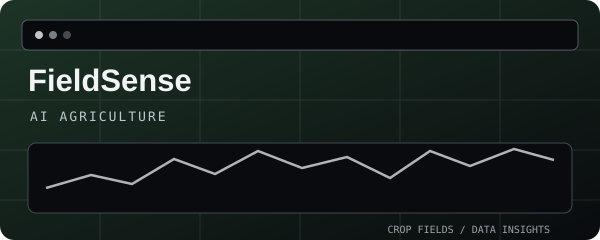
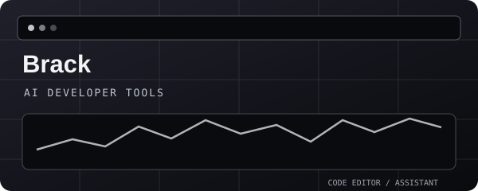
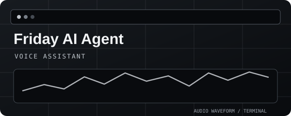
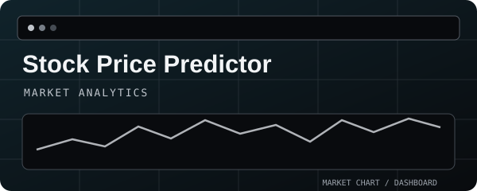
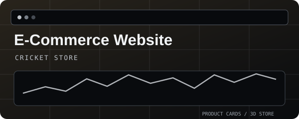
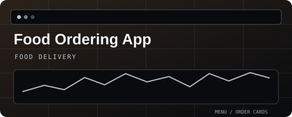
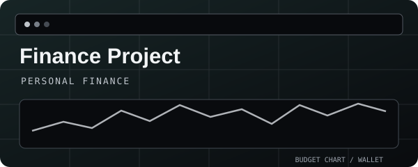
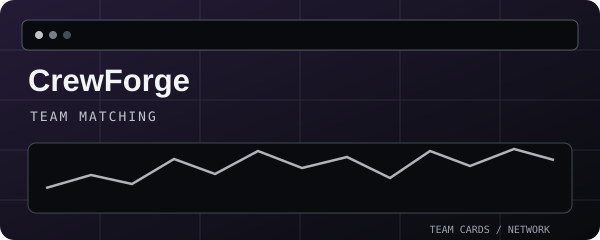

 

---

## ABOUT

I'm **Joe Flaming**, an AI & Data Science student building AI-powered tools, modern web applications, and practical digital products. I enjoy turning ideas into working software, exploring new technologies, and refining the details that make a product useful.

`AI & Data Science` · `Full-Stack Development` · `Machine Learning` · `Product Building`

---

## FEATURED PROJECTS

<table>
<tr>
<td width="50%" valign="top">

### FieldSense

Smart agriculture platform with AI insights, weather data, and crop analysis.

`AI` `Web` `Agritech`

[⌘ Browse repositories](https://github.com/joeflaming777-lgtm?tab=repositories)

</td>
<td width="50%" valign="top">

### Brack

Personal GitHub alternative with AI code rewriting, bug fixing, and developer tools.

`AI` `Developer Tools` `Web`

[⌘ View code](https://github.com/joeflaming777-lgtm/brack-)

</td>
</tr>
<tr>
<td width="50%" valign="top">

### Friday AI Agent

Real-time AI voice assistant with speech interaction and conversational AI.

`Python` `AI` `Voice`

[⌘ View code](https://github.com/joeflaming777-lgtm/friday-AI-agent-)

</td>
<td width="50%" valign="top">

### Stock Price Predictor

Machine-learning dashboard for stock forecasting and technical analysis.

`ML` `Data Analysis` `Finance`

[⌘ View code](https://github.com/joeflaming777-lgtm/stock-price-predicator)

</td>
</tr>
<tr>
<td width="50%" valign="top">

### E-Commerce Website

Cricket shopping platform with 3D product viewing, cart, wishlist, and customization.

`Web` `E-Commerce` `3D`

[⌘ View code](https://github.com/joeflaming777-lgtm/e-commerce-Website)

</td>
<td width="50%" valign="top">

### Food Ordering App

Food ordering system with Flask, SQLite, payments, and order tracking.

`Python` `Flask` `Web`

[⌘ View code](https://github.com/joeflaming777-lgtm/food-ordering-app)

</td>
</tr>
<tr>
<td width="50%" valign="top">

### Finance Project

Personal finance app for expenses, income, savings, and budget management.

`Python` `Data` `Web`

[⌘ View code](https://github.com/joeflaming777-lgtm/finance-project-)

</td>
<td width="50%" valign="top">

### CrewForge

Hackathon team formation platform with skill assessments, GitHub analysis, and candidate matching.

`React` `Node.js` `Web`

[⌘ View code](https://github.com/joeflaming777-lgtm/Crew-forge) · [Live demo](https://crewforge-00vh.onrender.com/)

</td>
</tr>
</table>

---

## TECH STACK

| Languages | Web & Backend | AI & Data | Tools |
|:---:|:---:|:---:|:---:|
| Python · Java · C · JavaScript | React · Node.js · Express · Flask | PyTorch · OpenCV · Scikit-learn | Git · GitHub · VS Code · Docker |

---

## LET'S CONNECT

Always open to interesting ideas, collaborations, and opportunities to build.

  

*Learn. Build. Refine.*

